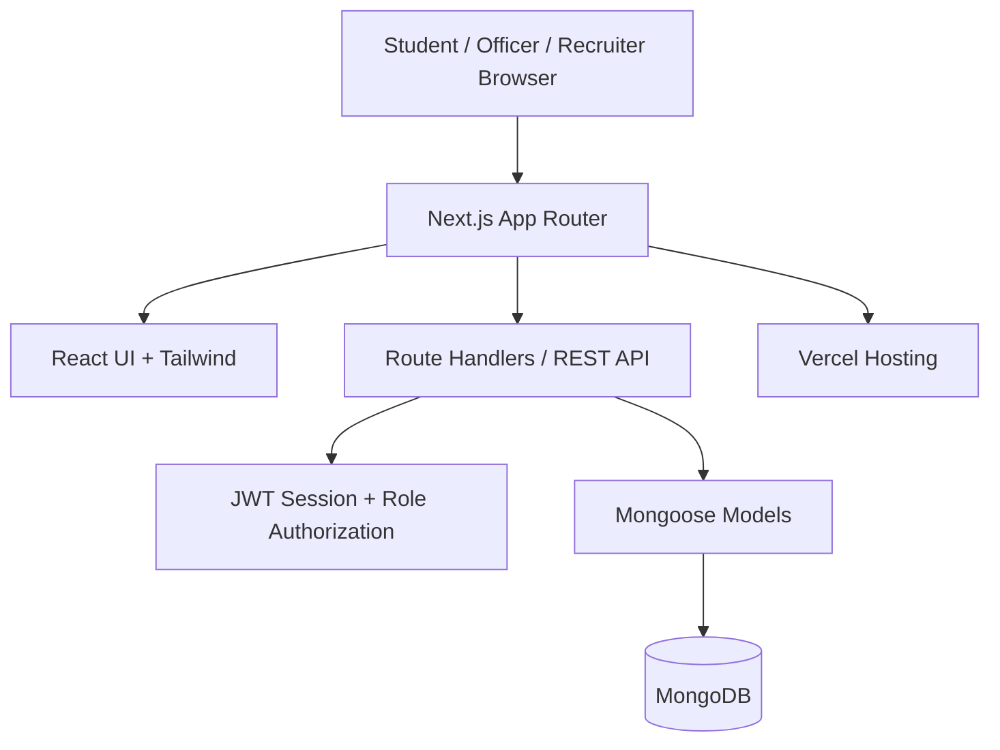

# System Architecture

## Logical architecture

## Design decisions

- **Next.js App Router:** combines page rendering and API route handlers in one deployable application.
- **MongoDB + Mongoose:** document-oriented storage for user profiles, placement drives and applications.
- **Signed HTTP-only cookie:** reduces exposure of session tokens to browser JavaScript.
- **Role-based authorization:** student, officer and company permissions are checked on the server, not merely hidden in the UI.
- **Unique application index:** prevents the same student from applying to the same drive more than once.

## Trust boundaries

Browser input is untrusted. API routes validate request payloads, derive the user identity from the signed session, and apply authorization before database writes. Secrets are supplied through environment variables and must not be committed.

## Current MVP gaps

Profile editing, resume storage, officer status transitions, recruiter applicant-management screens, email notifications, audit logs, CSRF hardening beyond same-site cookies, rate limiting and automated unit tests remain future work. These should be prioritized before any real institutional deployment.
