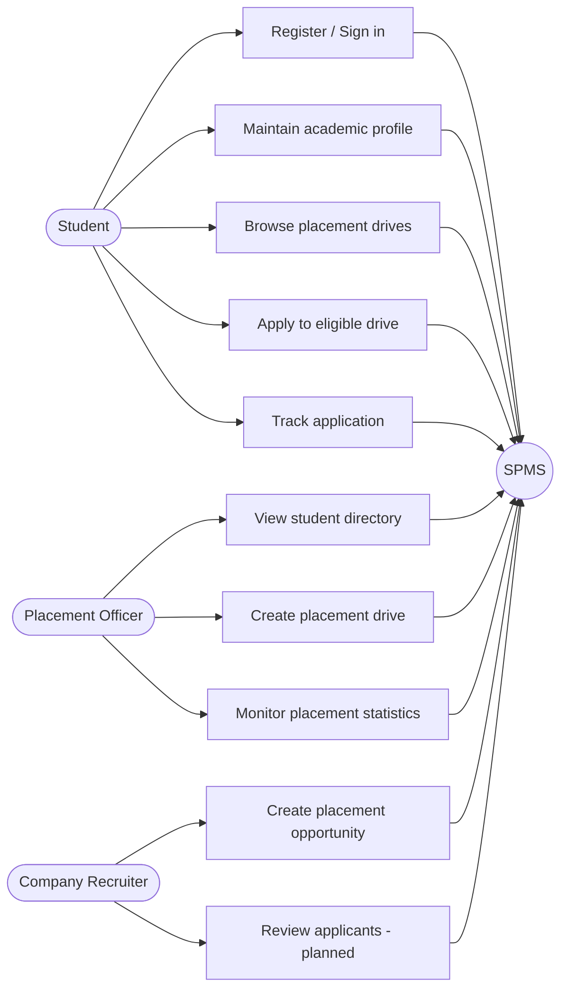

# UML Use Cases

## Use case: Apply to placement drive

- **Primary actor:** Student
- **Precondition:** Student is authenticated and has a student role; drive is open and before deadline.
- **Main flow:** Student opens a drive → system loads eligibility requirements → student submits application → system validates CGPA, backlog count, department and graduation year → application is saved → confirmation is returned.
- **Alternative flows:** Ineligible student receives a clear rejection; duplicate application is rejected; closed/expired drive cannot accept applications.
- **Postcondition:** One application record exists for the student-drive pair.
